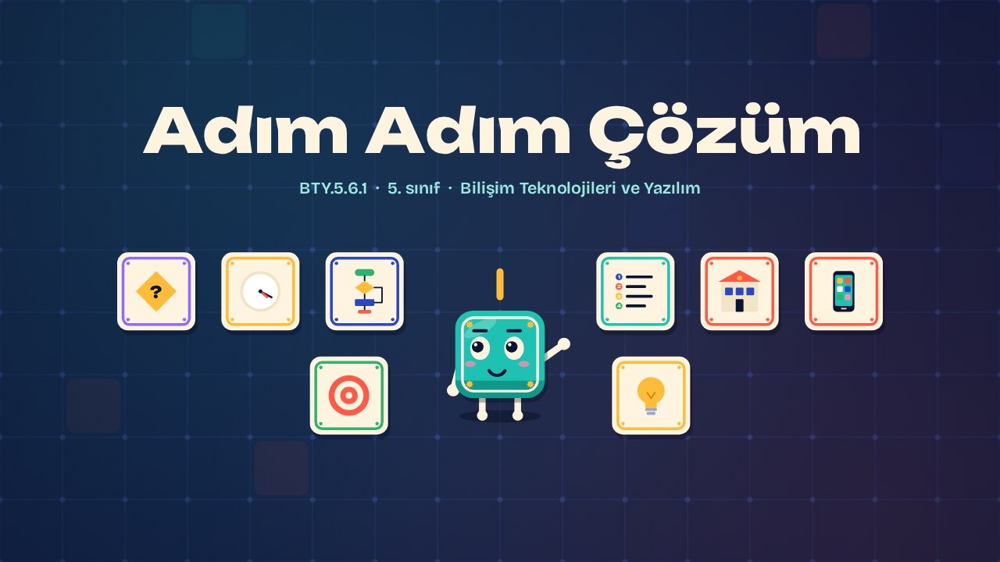
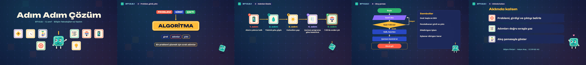

# Adım Adım Çözüm · Step by Step

**▶ Tarayıcıda izleyin / Watch in the browser:** https://hakanatas.github.io/adim-adim-cozum/ 
**⬇ MP4 + altyazılar / MP4 + subtitles:** [Releases](https://github.com/hakanatas/adim-adim-cozum/releases) 
**✎ Kullanılan istem / The prompt behind it:** [PROMPT.md](PROMPT.md) 
**🎞 Bütün filmler / All films:** [Bilişim Filmleri](https://hakanatas.github.io/bilisim-filmleri/?sinif=5)

> **TR —** 5. sınıf Bilişim Teknolojileri ve Yazılım dersinin "Yazılım Tasarımı ve Programlama" temasındaki BTY.5.6.1 öğrenme çıktısı için hazırlanmış, tamamen JavaScript ile çizilen 1,9 dakikalık animasyon; ses efektleri ve hafif fon müziği de kodla üretilir. Okula geç kalmak gibi günlük bir problem seçilir; problemin girdisi (saat, çanta, ders programı) ve çıktısı (okula zamanında varmak) belirlenir. Çözüm için işlem adımları sırayla listelenir ve bu adım dizisinin bir algoritma olduğu gösterilir. Akış şeması sembolleri (başla/bitir, girdi/çıktı, işlem, karar) tanıtılır ve aynı çözüm bir karar adımı içeren akış şemasıyla gösterilir. Altyazılar Türkçe, İngilizce ya da ikisi birlikte seçilebilir.

A 1.9-minute animation, with code-generated sound, for **5th-grade IT and Software** (Türkiye Yüzyılı Maarif Modeli). Karo picks an everyday problem (being late for school), names its inputs and output, lists the solution steps as an algorithm, meets flowchart symbols and draws the solution as a flowchart with a decision. The guide is **Karo**, a living glazed tile who never speaks: he tells the story with his face, his arms and the blinking cursor above his head.

## Öğrenme çıktısı · Learning outcome

MEB, Türkiye Yüzyılı Maarif Modeli, Bilişim Teknolojileri ve Yazılım Dersi Öğretim Programı, 5. sınıf, 6. tema "Yazılım Tasarımı ve Programlama":

**BTY.5.6.1. Problem çözümü için algoritmik düşünebilme**
- a) Günlük yaşamda karşılaştığı bir problemi belirler.
- b) Belirlediği problemin girdi ve çıktılarını belirler.
- c) Belirlediği problemin çözümüne ilişkin işlem adımlarını listeler.
- ç) İşlem adımlarını akış şeması ile gösterir.

## Sahneler · Scenes

| # | Zaman | Sahne | Ne oluyor | Çıktı |
|---|---|---|---|---|
| 1 | 0:00–0:16 | Giriş |  |  |
| 2 | 0:16–0:45 | Problem, girdi, çıktı | Günlük bir problemin girdi ve çıktıları. | a, b |
| 3 | 0:45–1:07 | Adımları listele | Çözüm için işlem adımları sırayla yazılır. | c |
| 4 | 1:07–1:40 | Akış şeması | İşlem adımları başla, girdi, işlem, karar ve bitir sembolleriyle akış şemasına dökülür. | ç |
| 5 | 1:40–1:56 | Aklında kalsın |  |  |

## Çalıştırma · Running it

- **Önizleme:** `index.html` dosyasına çift tıklayın (çevrim dışı da çalışır). Klavye: boşluk oynat/duraklat, ← → 3 sn, Home başa. Adrese `?altyazi=en`, `?bicim=vertical` ya da `?ses=0` eklenebilir.
- **MP4:** bir kez `npm install`, sonra `npm run export -- --format=both --captions=tr` (720p yatay ve dikey, sesli). Google Chrome yüklüyse Playwright onu kullanır (`channel: 'chrome'`); ffmpeg gerekir.
- **Altyazı ve seslendirme notları:** `npm run srt` → `out/adim-adim-cozum_tr.srt`, `_en.srt`, `_tr-en.srt`, `_seslendirme-notlari.txt`.
- **Sürüm dosyaları:** `npm run release` → `release/` klasöründe v1.0'ın 6 dosyası.
- **Yazı kontrolü:** `npm run check` yatay ve dikey düzende, üç altyazı seçeneğiyle üst üste binen, kenardan taşan ya da 720p'de 17 pikselden küçük kalan yazı arar.
- **Düzenleme:** senaryo (sahneler, altyazılar, seslendirme notları) `scenes/film.js` içindedir; değiştirince `npm run build` süreleri, `captions.js` ve `film.config.js` dosyalarını yeniden üretir. Sahne şablonları `src/kit/`, Karo `src/draw/karo.js`, ses `src/audio/synth.js`.

Her kare `renderFrame(t)` ile zamanın saf fonksiyonu olarak çizilir; rastgelelik tohumludur, MP4 ekran kaydı değil kare kare üretimdir. Ses de dosyadan çalınmaz: aynı olay listesinden hesaplanır. Yazı tipleri: Unbounded ve Bricolage Grotesque (SIL OFL 1.1), dosyaya gömülü.

## Lisans · License

**TR —** Bu film ve kodu [Creative Commons Atıf-GayriTicari 4.0 Uluslararası (CC BY-NC 4.0)](https://creativecommons.org/licenses/by-nc/4.0/deed.tr) lisansıyla paylaşılır. Ticari olmayan her amaçla (derste, okulda, eğitim materyalinde) kopyalayabilir, paylaşabilir ve değiştirebilirsiniz; ancak **kaynak göstermek zorunludur**: eser sahibinin adı ve bu deponun bağlantısı belirtilmeden kullanılamaz. Ticari kullanım (satış, ücretli ürün ya da yayın) için izin alınmalıdır.

**EN —** This film and its code are licensed under [Creative Commons Attribution-NonCommercial 4.0 International (CC BY-NC 4.0)](https://creativecommons.org/licenses/by-nc/4.0/). You may copy, share and adapt them for non-commercial purposes, but **attribution is required**: they may not be used without crediting the author and linking to this repository. Commercial use requires permission.

Atıf örneği / Required credit: *“Adım Adım Çözüm”, Hakan Ataş, Bilişim Filmleri — https://github.com/hakanatas/adim-adim-cozum — CC BY-NC 4.0*
